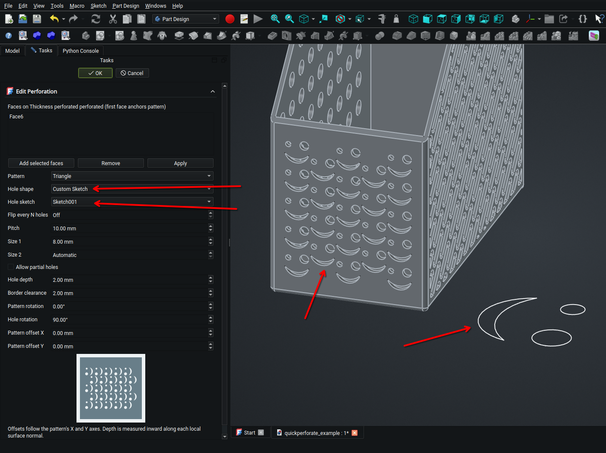

# Quick Perforate

A FreeCAD Part workbench extension that cuts decorative holes on selected faces.


## Installation

Quick Perforate is an addon that adds a **Perforate** button to the **Part** workbench. It does not appear as a separate workbench.

1. In FreeCAD, open **View → Panels → Python console** and run:

   ```python
   print(App.getUserAppDataDir())
   ```

2. Close FreeCAD. Inside the printed directory, create a `Mod` folder if it does not already exist.
3. Download this repository using **Code → Download ZIP** on [GitHub](https://github.com/kevinsmia1939/QuickPerforate), extract it, and rename the extracted folder to `QuickPerforate`. Place it inside `Mod`.
4. Check that the layout is `Mod/QuickPerforate/InitGui.py` and `Mod/QuickPerforate/freecad/QuickPerforate/`. Avoid an extra nested repository folder.
5. Restart FreeCAD and switch to **Part**. The **Perforate** toolbar contains the addon button. If hidden, enable it under **View → Toolbars → Perforate**.

Alternatively, clone the repository into the same `Mod` folder:

```bash
git clone https://github.com/kevinsmia1939/QuickPerforate.git QuickPerforate
```

To update a Git installation, close FreeCAD, run `git pull` inside `Mod/QuickPerforate`, then restart FreeCAD. For a ZIP installation, replace the addon folder with the newly downloaded version.

## Use
1. Switch to the **Part** workbench and select faces of an object.
2. Click **Perforate selected face** on the **Perforate** toolbar.
3. Choose a pattern and hole shape.


## Custom sketch holes



Create a sketch containing one or more closed, non-intersecting outlines. Construction geometry is ignored. Select **Custom Sketch** as the hole shape and choose the sketch in **Hole sketch**. Size 1 scales its largest overall dimension, preserving its proportions and true curves; Size 2 does not alter custom sketches. The outline is centered automatically and placed in each hole's local tangent plane. The sketch can be positioned elsewhere in the document; its original placement does not position the holes.

The feature links to the sketch, so editing the sketch updates the perforation on recompute. Open, touching, or intersecting outlines and sketches depending on the perforation itself are unsupported. Existing built-in hole shapes and saved perforations continue to work.

Quick Perforate adds one command button to Part's **Perforate** toolbar; it no longer registers a separate workbench. Restart FreeCAD after updating.

Moving and rotating an existing perforation reuses its computed geometry. The cut is rebuilt when its geometry inputs change, including the source, linked sketch, selected faces, or hole settings. The cache is kept in memory; the first recompute after opening a document can rebuild it. Custom sketch links use global link scope so sketches inside Part Design Bodies can be referenced without an out-of-scope warning.

Multiple sketch loops are treated as one repeated profile. Separate loops cut separate openings; nested loops alternate between cut regions and retained material. Size 1 scales the entire group while preserving relative positions. The preview uses the same nested-loop fill rule.
