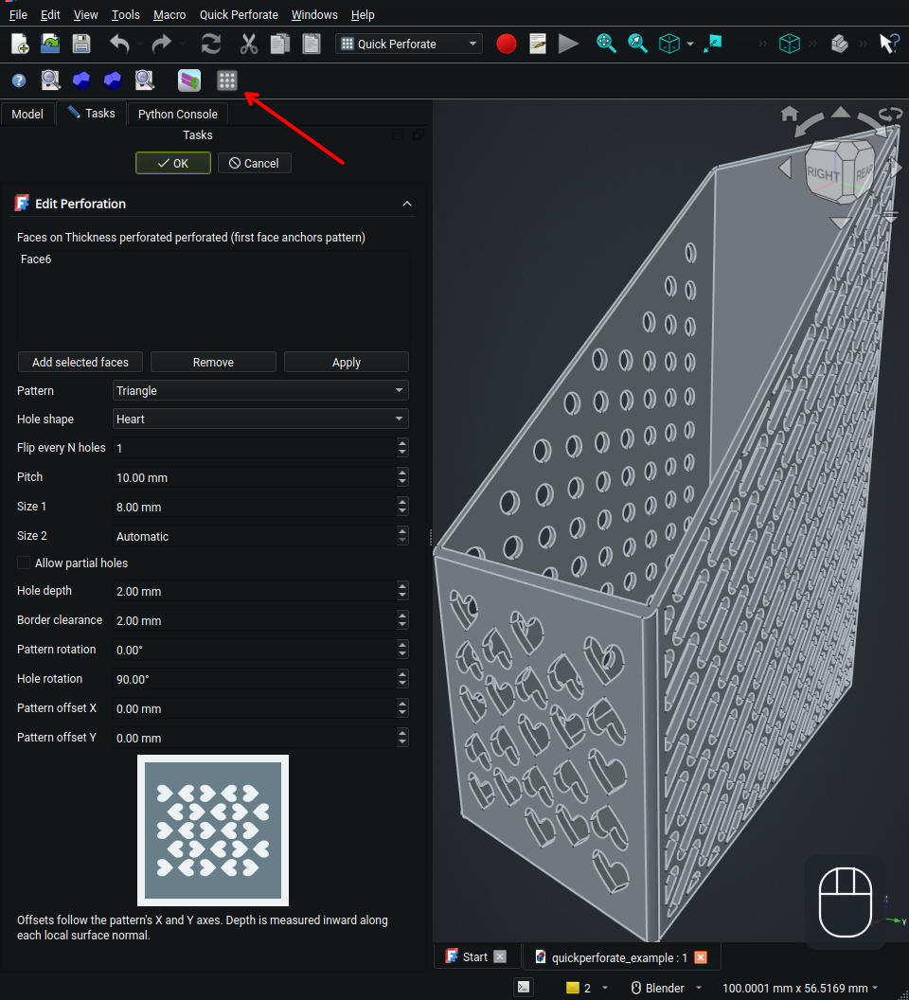

# Quick Perforate

A FreeCAD workbench that cuts decorative through holes in a solid from a selected planar face.

## Use
1. Select faces of an object.
2. Click **Perforate selected face** on the toolbar.
3. Choose a pattern and hole shape.

